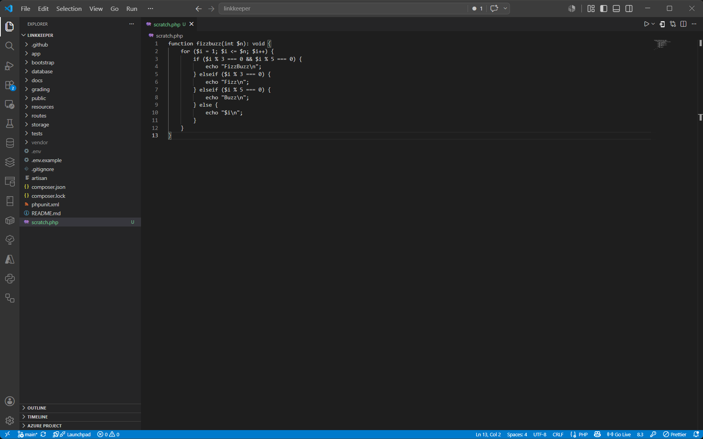

# Lab 0 submission

## Copilot suggestion screenshot

## What the app does

LinkKeeper is a small Laravel 13 bookmark manager. Each bookmark has a title, URL, an optional `visited_at` timestamp and a pinned flag, and you can list bookmarks, add new ones, and pin or unpin them. The seeder loads 30 sample bookmarks, and a `/health` endpoint returns JSON status. Key files: `routes/web.php` (routes), `app/Http/Controllers/BookmarkController.php` (index, store, togglePin), `app/Models/Bookmark.php` (model), `resources/views/bookmarks/index.blade.php` (view), and `database/seeders/DatabaseSeeder.php` (seed data).

## Oddity found

- `Bookmark` model docblock claims `visited_at` is never null and is stamped on creation. In reality the migration column is nullable, `store()` never sets it, and the seeder deliberately creates 3 never-visited bookmarks (the view even renders "never visited").
- `BookmarkController::index` docblock (and the Blade subtitle) say "pinned first, then newest-first", but the code uses `orderBy('pinned')` and `orderBy('created_at')`, both ascending, so unpinned bookmarks come first and the oldest come first.

Nothing was edited; `git status` is clean.

Session notes: orientation session was run in the Copilot CLI (Claude Sonnet) from the repo root `c:\Work\linkkeeper`.
